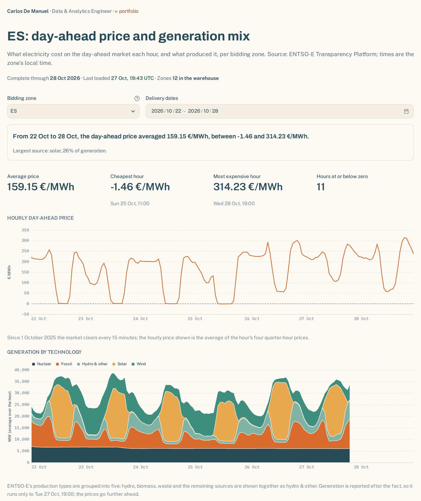
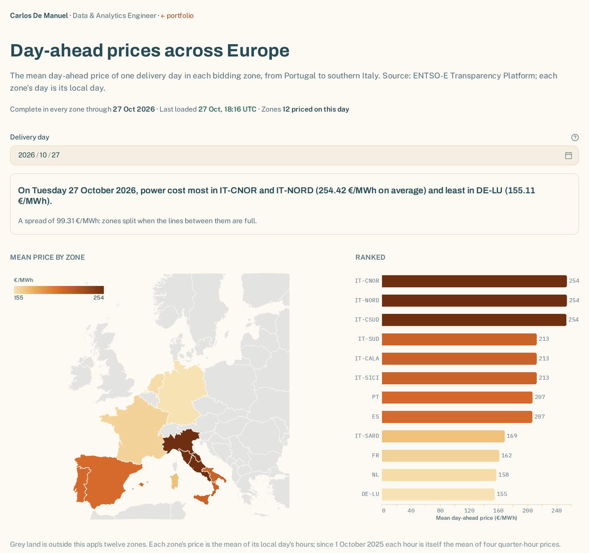
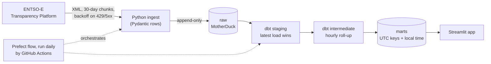

# Power Market Lens

### Why does electricity cost what it costs in Europe?

[](https://github.com/carlosdmv7/power-market-lens/actions/workflows/ci.yml)
[](https://github.com/carlosdmv7/power-market-lens/actions/workflows/pipeline.yml)


Every day, Europe's day-ahead auction sets tomorrow's electricity price, quarter-hour by
quarter-hour. The same megawatt-hour can be close to free at lunchtime and cost almost a hundred times
more in the evening. The price is published as a list of numbers, with nothing next to it
to explain it.

Power Market Lens puts the price next to what was producing the power at that hour. It is
built to grow into a platform that explains day-ahead prices across European bidding zones:
the generation mix, the drivers of the price, what households actually pay, and a day-ahead
price forecast for Spain.

> **Phase 1 of a five-phase roadmap.** Twelve bidding zones (Spain, Portugal, France,
> Germany–Luxembourg, the Netherlands and Italy's seven zones), with hourly day-ahead prices
> and generation by technology from January 2024, loaded daily from ENTSO-E. Load, cross-border
> flows, emission factors and the quarter-hour price mart are in review; forecasting and
> household prices come later ([roadmap](#roadmap)).

---

### What that looks like

> On **Tuesday 22 September 2026**, Spain's day-ahead price was **€3.01/MWh at 13:00**, when
> solar was 66% of generation. At **20:00** it was **€282.43/MWh**: solar had fallen below
> 3% and fossil plants supplied 40%.
>
> Across the 2,177 hours from 21 July to 19 October 2026, the hourly price and solar's share
> of generation have a correlation of **−0.85**. That is an observation, not a causal claim. Separating
> the drivers properly is the forecasting model's job in Phase 3.



The page answers its question in one sentence before any control. The two charts share one
time axis, so an hour sits at the same position in both. Any of the twelve bidding zones can be
picked (`?zone=FR` in the URL), and times are the zone's local time. A map page compares one
day's mean price across all twelve:



---

## What it refuses to pretend

- **Prices are shown as published, out-of-range values included.** Values outside the SDAC
  harmonised limits in force on their delivery day are flagged in the warehouse and on the
  page, never dropped. The limits come from a dated seed, because the floor moved from
  −500 to −600 €/MWh for delivery from 29 May 2026.
- **An hour is a local hour.** Spanish days have 23, 24 or 25 hours. Keys are UTC, local
  dates and hours are derived explicitly, and the completeness tests know how long each day
  is. On the 25-hour day the charts draw the repeated 02:00 as the mean of its two hours,
  never their sum; the warehouse keeps both.
- **Missing data stays missing.** ENTSO-E never published generation for Spain after the
  Iberian blackout of 28 April 2025, nor for a few French hours. Those days are listed, with
  their cause, in a seed the completeness test reads; any other gap still fails the pipeline
  ([ADR-006](docs/adr/0006-known-source-gaps.md)).
- **Since October 2025 the market clears every 15 minutes.** The hourly price is the mean
  of the hour's quarter-hours, and the page says so. Raw and staging keep the native
  resolution.
- **Generation is reported after the fact; prices are set a day ahead.** The page shows
  where the generation data stops instead of stretching one chart to fit the other.
- **Five colours, not fifteen.** ENTSO-E reports about fifteen production types for Spain.
  The chart groups them into five so each stays distinguishable, and says which types share
  the "hydro & other" band.

---

# How it's built



| Layer | Tool | Why this one |
|---|---|---|
| Source | ENTSO-E Transparency Platform via `entsoe-py`'s raw client | Free, and the official pan-European source. The XML is parsed here, so curve types and gaps are handled explicitly. |
| Warehouse | MotherDuck (DuckDB), `power_dev` and `power_prod` | Free tier, serverless, the same SQL locally and in the cloud ([ADR-001](docs/adr/0001-motherduck-over-bigquery.md)) |
| Transform | dbt-duckdb: staging → intermediate → marts | Tested, documented SQL with lineage |
| Orchestration | Prefect flows, executed by a GitHub Actions workflow | Run history and retries without a paid worker, and without spending the free tier's deployment quota ([ADR-002](docs/adr/0002-prefect-flows-run-by-github-actions.md)) |
| App | Streamlit + Altair | Reads only materialised marts |
| Quality | ruff, sqlfluff, pytest, dbt data and unit tests, pre-commit | One gate locally (`make check`) and in CI |

### Decisions worth defending

- **Raw is append-only.** Every run re-pulls the last 7 days to pick up publisher
  revisions, and staging keeps the latest load of each interval. Re-running a load changes
  nothing downstream; this was tested on real data by loading the same 90 days twice.
- **Time is handled in one place.** UTC keys, and a single macro for local columns with
  explicit `AT TIME ZONE`. Every dbt target pins the session to UTC, because MotherDuck
  otherwise inherits the machine's zone (Madrid on a laptop, UTC on a runner)
  ([ADR-003](docs/adr/0003-time-dst-and-resolution.md)).
- **The parsers are tested against real responses.** The tests use recorded ENTSO-E
  responses: the 25-hour autumn day of 2025, where 91 published points expand to 100
  quarter-hours; the 23-hour spring day of 2026, with negative prices; and every Spanish
  production type. No test touches the network; `make record-fixtures` re-records them.
- **Prod has exactly one writer.** The Pipeline workflow refuses to run on any ref but
  `main`. CI builds every pull request in its own `ci_*` schemas. The history since
  January 2024 was backfilled through the same workflow, one quarter per run, so the
  backfill and the daily load share one code path.

### Data quality

Each build runs 82 dbt nodes: seeds, models, data tests and unit tests. Among them:

- complete local days per zone, at 23, 24 or 25 hours, except the source gaps listed in a
  seed;
- `unique` and `not_null` on every key, and a check that the SDAC limits seed is contiguous
  and non-overlapping;
- unit tests for both DST changes, for staging's deduplication, and for picking the finest
  resolution an hour was published in.

After every daily build, `dbt source freshness` checks the newest interval ENTSO-E has
delivered. A run that succeeds but brings nothing new turns the pipeline red once the data
is 36 hours old, and logs a warning after 12.

## Quickstart

```bash
make install       # uv sync, .env from .env.example, pre-commit hooks, dbt deps
make check         # ruff + sqlfluff + pytest, the same gate CI runs
```

Loading data needs a free [ENTSO-E API token](https://transparency.entsoe.eu/) and a
[MotherDuck](https://motherduck.com/) token in `.env`:

```bash
make backfill START=2026-07-21 END=2026-10-20   # into power_dev, then dbt build
make app WAREHOUSE_PATH=md:power_dev
```

Requires [uv](https://docs.astral.sh/uv/). `make help` lists every command.

## Project layout

```text
src/power_market_lens/   config, zones, ENTSO-E ingest, Prefect flows
transform/               dbt project: seeds, staging → intermediate → marts, tests
app/                     Streamlit router, pages (views/), charts, map shapes (assets/)
scripts/                 re-recording the ENTSO-E test fixtures; building the map shapes
tests/                   pytest, mirroring src/ and app/, with recorded API fixtures
docs/adr/                architecture decision records
```

## Roadmap

| Phase | Scope |
|---|---|
| 0 (done) | Foundations, and a Spain-only slice: day-ahead prices and generation, loaded daily |
| **1 (current)** | All bidding zones, load, cross-border flows, technology mapping and emission factors, a 2–3 year backfill; map and zone-mix pages |
| 2 | MetricFlow metrics (renewable share, carbon intensity, average price, spread); household price composition from Eurostat and the Spanish PVPC from ESIOS |
| 3 | Day-ahead price forecast for Spain: leakage-safe features, rolling-origin backtests against a naive baseline, prediction intervals, SHAP drivers |
| 4 | Slim CI with deferral to the prod manifest, dbt docs on GitHub Pages, a case study |

## Limitations

- Prices and generation are live for twelve zones. Load and cross-border flows are loaded
  into raw daily, but their marts, the emission factors and their pages are still in review. Forecasting and
  household prices are not answered yet.
- Generation is ENTSO-E's actual generation per type, as reported by the TSO. It can arrive
  late and be revised, which is why every run re-pulls a week.
- The page's five generation groups are a display choice. A modelled technology mapping
  in dbt, in review, replaces them.

## License

MIT, see [LICENSE](LICENSE).
